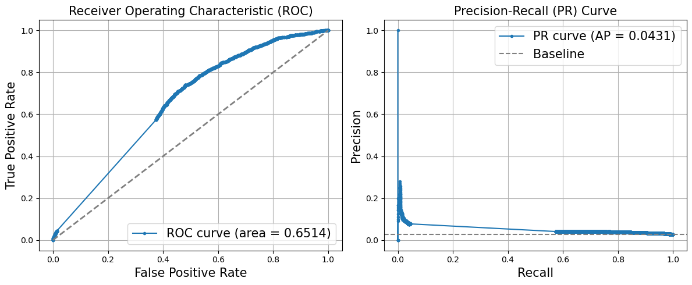
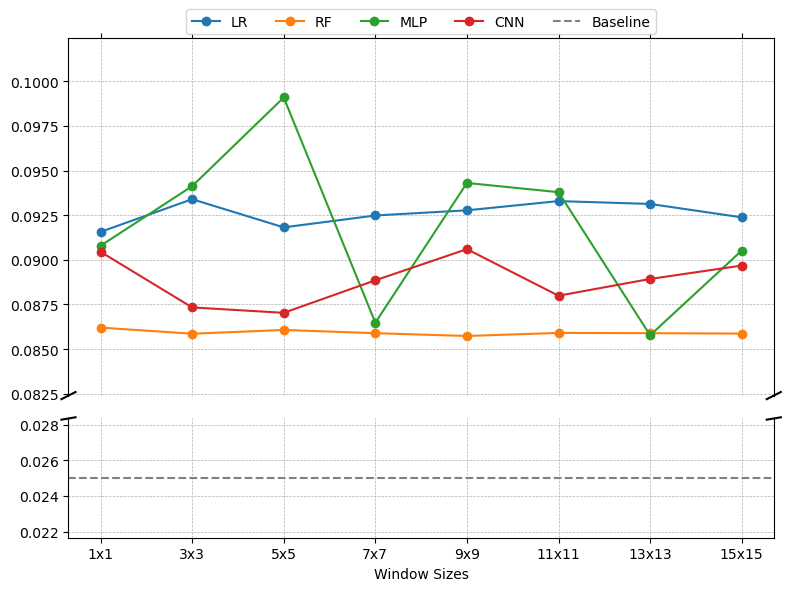

# Predicting Sewage Pollution at UK Bathing Waters from Satellite Data

LSE MSc Data Science capstone project (2022/23). We built binary classifiers that predict increased sewage pollution risk at bathing water sites along the English coastline, using ocean colour satellite data from Copernicus Marine Service and pollution risk labels from the Environment Agency.

📄 **[Read the full report (PDF)](report/final_report.pdf)**



## Why it matters

- England recorded 301,091 sewage spills in 2022, about 824 per day
- Current monitoring (event duration monitors, manual sampling) is costly and only covers fixed locations
- Satellite remote sensing could offer cheaper, wider and more timely coverage

## Data

| Source | What | Scope |
|---|---|---|
| Environment Agency | Daily pollution risk forecasts for bathing water sites (labels) | 2020 to 2022, May to September |
| Copernicus Marine, Sentinel-3 (S3) | 6 ocean colour variables (CHL, SPM, ZSD, KD490, BBP, CDM), 1km resolution, revisit under 2 days | L3 daily, extracted per site |
| Copernicus Marine, Sentinel-2 (S2) | 3 variables (CHL, SPM, turbidity), 100m resolution, ~10 day revisit | L4 interpolated daily, 20km coastal zone |

Key challenge → heavily imbalanced labels (~2.8% positive) and large spatial and temporal gaps in satellite coverage.

## Approach

1. **Extraction** → looped API calls per site via the MOTU client, merged NetCDF files into one tabular dataset
2. **Feature engineering** → aggregated pixels in square windows around each site (mean, median, q1, q3), giving 192 features per site-day for S3 (1x1 to 15x15) and windows up to 51x51 for S2
3. **Missing data** → spatial gaps filled with grouped means, temporal gaps filled with 0 (F0) or -10 (F-10)
4. **EDA** → missingness patterns, correlation with risk labels, PCA, k-means clustering of high-risk days
5. **Models** → baseline (random by class prior), logistic regression, random forest, MLP, CNN (raw pixel windows as image channels)
6. **Imbalance handling** → class weights, oversampling, image augmentation (flips and rotations) for the CNN, F1 as tuning metric
7. **Evaluation** → F1, precision, recall, average precision, ROC-AUC, broken down by year, month, region and cluster

## Results

Best models on S3 data (test set):

| Model | F1 | Precision | Recall | ROC-AUC |
|---|---|---|---|---|
| Baseline | 0.024 | 0.024 | 0.025 | 0.498 |
| Logistic regression | 0.075 | 0.040 | 0.619 | 0.603 |
| **Random forest** | **0.079** | **0.042** | 0.666 | **0.651** |
| MLP | 0.076 | 0.040 | **0.735** | 0.625 |
| CNN | 0.077 | 0.041 | 0.668 | 0.627 |

Higher resolution S2 data with a 51x51 window lifted the random forest to **F1 0.282, precision 0.917, ROC-AUC 0.790**.

Takeaways:
- All models beat the baseline by roughly 3x on F1, but absolute performance stays low, which reflects how hard this signal is to detect from satellite data alone
- Feature engineering helped classical models (LR, RF) much more than raw inputs
- Spatial resolution mattered more than window size; larger windows did not consistently help
- Performance varied by region, with the east coast of England hardest to predict
- Next steps: more data, lagged history, and confounders such as weather and bathymetry



## Repository structure

```
├── notebooks/
│   ├── 01_data_extraction/      # Copernicus S2/S3 download, EA risk data, site to region mapping
│   ├── 02_feature_engineering/  # Window-based feature extraction
│   ├── 03_eda/                  # Bathing water and satellite EDA, PCA, k-means, window sizes
│   ├── 04_models/               # Baseline, logistic regression, random forest, MLP, CNN
│   └── 05_early_experiments/    # Earlier iterations of EDA and models
├── data/
│   ├── raw/                     # Copernicus NetCDF and CSV extracts, EA risk forecasts, sites
│   ├── processed/               # Clustered test set, CNN window size results
│   └── splits/                  # Train / validation / test labels and time-site pairs
├── models/                      # Saved best random forest (.joblib) and CNN (.keras) models
├── figures/                     # Extra plots: SPM by region, risk change by month and year
└── report/                      # Final report (PDF, LaTeX source, figures)
```

## Running it

```bash
pip install -r requirements.txt
jupyter lab
```

Downloading fresh satellite data needs a free [Copernicus Marine](https://marine.copernicus.eu/) account. Set credentials as environment variables:

```bash
export COPERNICUS_USER=your_username
export COPERNICUS_PASSWORD=your_password
```

## My contributions

- Built the Copernicus satellite extraction pipeline and the window-based feature engineering
- Processed the Environment Agency pollution risk forecasting data and ran EDA on bathing water data
- Compared model performance across window sizes and built the S3 baseline
- Developed early random forest and combined-model experiments
- Compiled and edited the final report

## Team and credits

Group project with two LSE MSc classmates (ST498 Group 6), supervised by Marcos Barreto. Original team repository: [lse-st498/P6_WaterPollution_2022_23](https://github.com/lse-st498/P6_WaterPollution_2022_23).

Data: [Environment Agency bathing water quality](https://environment.data.gov.uk/bwq/profiles/) (Open Government Licence) and [Copernicus Marine Service](https://marine.copernicus.eu/).
